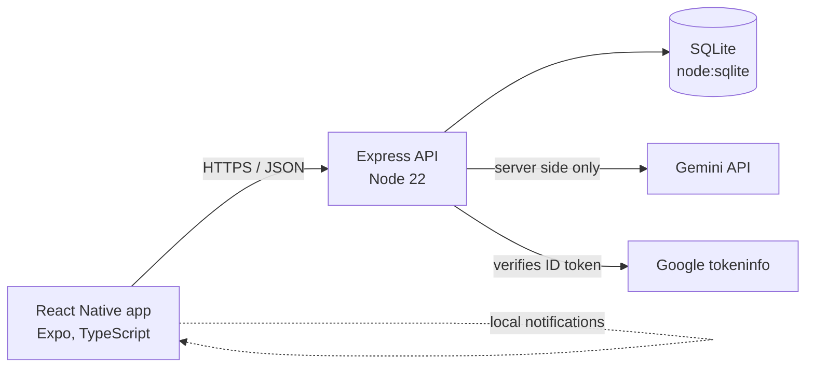

# Solace

**An AI wellness companion that remembers you and guides your day.**
Built for the Solace AI hackathon (2026). A React Native app, a Node.js API and an AI layer designed around one idea: *a calm place to land, one small thing at a time.*

> Screenshots: add images to `docs/` and link them here.

## What it does

| Area | Details |
| --- | --- |
| **Sunny, the AI companion** | Warm, specific replies; understands mood (the mascot's face changes); remembers what matters; suggests a real in-app activity when it helps |
| **Memory you control** | View, delete, clear or switch off everything Sunny remembers. With memory off, no history is used |
| **Daily note** | Written by AI each morning from your mood, goals and memories, with a personal affirmation and one suggested activity |
| **Small daily challenge** | One tiny, kind task chosen for how you feel; +XP, once a day |
| **Check-ins** | One-tap mood check-in, plus three gentle screenings (mood, anxiety, self-love), one question per screen, never a diagnosis |
| **Breathing and resources** | Guided breathing, five guides with tappable steps, therapists near you (location or city), crisis helplines |
| **Progress** | XP, levels, streaks, a 7-day mood chart and badges |
| **Reminders** | Local notifications with a time picker; work when the app is closed and open the right screen when tapped |
| **Privacy** | Account and data deletion, memory controls, no AI key in the app |
| **Auth** | Email accounts (bcrypt + JWT) and Google sign-in on Android, verified server-side |

## Architecture



- **App:** Expo Router (file-based routes), Reanimated for motion, expo-notifications for reminders, expo-secure-store for the session, expo-location for therapists.
- **API:** Express, JWT auth, an in-memory rate limiter, and a wrapper that forwards async errors to a single error handler. SQLite uses Node's built-in `node:sqlite`, so there is nothing native to compile.
- **AI keys never ship in the app.** The app only talks to the API.

## The AI layer (what sits on top of the model)

1. **Persona and style rules**: a system prompt defines Sunny's voice (specific, short, at most one question, no clichés).
2. **Personal context** (only with consent): name, goals, last 7 mood check-ins, recent screening results and saved memories are added to every request.
3. **Long-term memory**: after a chat, a second small call extracts up to two durable facts, skipping sensitive details such as diagnoses.
4. **Structured output**: the model returns JSON `{reply, mood, suggestion}`. The server only accepts suggestions from a fixed list of eight in-app activities, so the AI cannot invent features.
5. **Beyond chat**: the same pipeline writes the daily note and affirmation and picks the daily challenge, each cached per day with a rule-based fallback if the AI is unavailable.
6. **Safety**: messages that signal self-harm are answered by the server **before any model call** with Tele-MANAS (14416) and 112, never saved as a memory or a title. The prompt also forbids diagnosis.
7. **Resilience**: models are tried in order, skipping retired (404) or rate-limited (429/503) ones, and the working model is remembered.

## Run it locally

Requirements: Node 22.13+, an Expo-compatible phone or emulator, optionally a free Gemini key from Google AI Studio.

```bash
# 1. API
cd backend
cp .env.example .env        # set GEMINI_API_KEY and JWT_SECRET
npm install
npm start                   # http://localhost:4000/health

# 2. App
cd ../app
cp .env.example .env        # set EXPO_PUBLIC_API_URL (your computer's LAN IP, or a deployed URL)
npm install
npx expo start
```

Without a Gemini key the API still runs, with simple rule-based replies, which is useful for development.

## Tests

```bash
cd backend && npm test      # 21 end-to-end API tests on a temporary database
cd app && npx tsc --noEmit  # type-check
```

The backend tests start the real server and cover accounts, XP and streak rules, the daily challenge, chat history and ownership, memory controls, account deletion, Google sign-in (against a fake Google), rate limiting, startup checks and AI safety (a crisis message never reaches the model; invented activities are dropped). GitHub Actions runs them on every push.

## Deploy

**Backend** (Render, free): root directory `backend`, build `npm install`, start `npm start`, Node 22. Set `GEMINI_API_KEY`, `JWT_SECRET` and optionally `DEMO_EMAIL` / `DEMO_PASSWORD`. The server refuses to start on a host with the example JWT secret.

On a free plan the database is wiped when the service sleeps or redeploys. A demo account is recreated at every start, and an uptime monitor pinging `/health` keeps the service awake. For permanent data use a paid instance with a disk and set `DB_PATH=/data/solace.db`.

**App** (Android APK via EAS): put your API URL in `app/eas.json`, then `npx eas-cli build --platform android --profile preview`.

## Google sign-in (Android)

Works on a real device. It is hidden in Expo Go and in builds without a client ID, so email login never depends on it.

**How it works:** the app opens Google's account chooser (authorization code flow with PKCE) and exchanges the code for an ID token. The server then verifies that token with Google (audience, issuer, verified email) before it creates or signs in an account. New Google users get a short three-step "about you" setup.

**Status:** the Google Cloud project is in *Testing* mode, so only accounts added as test users can sign in. To open it to everyone, publish the OAuth consent screen, which needs a public home page and privacy policy URL (GitHub Pages works).

**Set it up for your own build**

1. Read your keystore SHA-1: `npx eas-cli credentials --platform android`.
2. In Google Cloud Console create an **Android** OAuth client for package `com.solace.wellness` with that SHA-1, and under Advanced settings tick **Enable custom URI scheme** (it can take a while to apply).
3. Set `GOOGLE_CLIENT_IDS` on the server and `EXPO_PUBLIC_GOOGLE_ANDROID_CLIENT_ID` in the EAS build env (`app/eas.json`), then rebuild.

## API overview

| Method | Path | Purpose |
| --- | --- | --- |
| POST | `/auth/signup`, `/auth/login`, `/auth/google`, `/auth/check-email` | Accounts |
| DELETE | `/auth/account` | Delete account and all data |
| POST | `/me/setup` | Goals, how you feel, check-in time |
| GET / POST | `/conversations`, `/conversations/:id/messages` | Chat history and messages |
| GET / DELETE | `/memories` | View and delete what Sunny remembers |
| POST | `/moods`, `/assessments`, `/activities` | Check-ins and activities (award XP) |
| GET | `/daily/note`, `/daily/challenge` | Personalised daily content |
| GET | `/progress` | Level, streak, chart, badges |
| GET / POST / PATCH / DELETE | `/reminders`, `/reminders/:id` | Reminder settings |

## Known limits and next steps

- SQLite on one instance is right for a prototype; the next step is Postgres and a migration tool.
- Replies arrive whole rather than streamed.
- Reminders are local notifications, not push; server-driven push is a next step.
- Google sign-in is Android only and in Google's Testing mode; Apple sign-in is not implemented.
- No vector search or fine-tuning: memory is a short list of facts, by design.
- Not a medical product. Screenings are friendly check-ins, not diagnoses.

## License

MIT. See [LICENSE](LICENSE).
